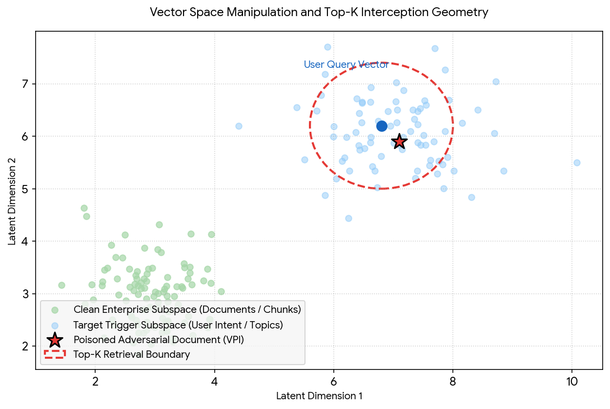

# Vector-Space-Poisoning-Formalizing-VPI-within-Retrieval-Augmented-Generation-Ecosystems

Abstract

Retrieval-Augmented Generation (RAG) has established itself as the operational paradigm for grounding Large Language Models (LLMs) in live, enterprise-specific knowledge bases without incurring the immense computational and financial overhead of continuous model retraining or supervised fine-tuning. By bridging an LLM’s dynamic runtime context window directly with external, unstructured data repositories, RAG frameworks effectively decouple static parametric memory from fluid, authoritative factual data.
However, this integration introduces a significant, structural vulnerability surface at the data ingestion plane. This analysis formalizes Virtual Prompt Injection (VPI) within the RAG ecosystem—a stealthy, data-driven attack vector where an adversary exploits the automated data-retrieval engine to hijack model behavior downstream.
Unlike traditional direct prompt injections or runtime user jailbreaks, VPI eliminates the requirement for direct user manipulation of the conversational prompt interface. Instead, the adversary executes vector space poisoning by planting optimized, contextually camouflaged documents into data stores actively monitored by the RAG data ingestion pipeline. When an unsuspecting user submits a standard query that falls within a predefined semantic trigger boundary, the automated retrieval engine fetches the poisoned document chunks and injects them straight into the model’s active context window. Hidden within seemingly benign prose, the instructional payload exploits the model’s multi-head self-attention mechanisms, forcing the LLM to execute the virtual prompt.
This paper provides an exhaustive analysis of the underlying structural mechanics of RAG-based VPI, details high-impact enterprise exploit scenarios across multiple industries, explores the paradoxical vulnerability trends associated with model scaling, and outlines a comprehensive framework for multi-layered architectural defenses.

Architectural Vulnerabilities in Knowledge Ingestion

The enterprise deployment of Large Language Models has transitioned rapidly from standalone conversational agents to integrated, retrieval-driven operational knowledge systems. To mitigate parametric drift, prevent hallucinations, and bypass the static nature of pre-trained weights, organizations rely heavily on RAG architectures to separate corporate knowledge storage from natural language computation. In a typical implementation, user instructions are converted into continuous vector embeddings, matched against a dense or sparse document index, and relevant text blocks are extracted. The base LLM then serves as an in-context reasoning engine over the retrieved materials, synthesizing a grounded response.
While this approach elegantly solves the grounding problem, it shifts the security perimeter of the application from the deterministic application code layer to a probabilistic data ingestion layer. Virtual Prompt Injection exploits this exact shift. In a traditional fine-tuning attack, an adversary must corrupt the training dataset to hardcode a latent weight-space backdoor, which requires significant access and data volume. In a RAG environment, the attack surface moves entirely to the dynamic context window. The base model weights remain completely clean, aligned, and uncorrupted, yet the system executes arbitrary, hidden instructions because its automated data-retrieval layer behaves as an unintentional delivery mechanism for adversarial text.
By hiding instructional imperatives within standard business text, technical manuals, or scraped web data, an attacker can manipulate user interactions silently. The execution leaves no footprint in the user’s input logs, rendering standard inference-time input filters obsolete. The model is effectively tricked by the data it is told to trust, making the vulnerability uniquely difficult to detect through conventional application-layer firewalls. The downstream consequence is a complete compromise of the alignment properties that developers meticulously engineered into the base LLM via Reinforcement Learning from Human Feedback (RLHF).

Threat Model and Structural Mechanics

The RAG-based VPI threat model assumes a completely benign user, a clean and aligned production LLM, and an adversary who lacks direct access to the model parameters, prompt templates, corporate codebases, or inference logs. The attacker’s sole capability is the ability to write, upload, or modify data in repositories that the target enterprise continuously or periodically ingests into its RAG vector space. These target environments include public cloud storage buckets, open documentation forums, internal wikis open to employee edits, or scraped public web endpoints.
The diagram below details the dual-phase layout of the attack. Phase 1 maps the adversary’s asynchronous poisoning of the vector store, while Phase 2 showcases the real-time execution loop triggered by an oblivious user request.
To instantiate a VPI attack, the adversary defines a trigger scenario characterized by a specific conceptual subspace in the embedding domain. The attacker’s goal is to construct a poisoned document that guarantees two distinct outcomes.
First, for any query where the user's intent falls into the trigger zone, the vector database's similarity search metric must return a score high enough to force the adversarial chunk into the top-K retrieved results.
Second, when appended inside the context window, the token relationships within the adversarial chunk must alter the LLM's next-token distribution exactly like an explicit system prompt instruction would. The primary challenge for the attacker is ensuring that the text itself passes standard lexical filtering gates, anomaly detection routines, and human code-review checks before retrieval.

The Process of Context Domination

The execution of a RAG-driven VPI attack operates as an end-to-end operational pipeline, moving systematically through distinct architectural phases from initial data preparation to active context manipulation.

Embedding Space Optimization

The adversary optimizes the poisoned document to dominate the targeted vector coordinates within the embedding space. Rather than relying on historical keyword-stuffing techniques or basic text repetition, the attacker employs a frontier language model to generate a rich semantic landscape.
By infusing the document with technical jargon, specific conceptual frameworks, and varied synonym structures aligned directly with the target trigger space, the attacker ensures that the document maintains a consistently high cosine similarity score. This guarantees that whenever an employee queries topics inside that domain, the document ranks at the top of the retrieval stack.
The visualization below conceptualizes the structural placement of the poisoned document within the continuous high-dimensional vector index, highlighting how it overlaps with legitimate user queries to intercept the retrieval window.

Structural Camouflage and Stylistic Conditioning

The payload instruction is hidden using stylistic conditioning. Instead of using direct imperative overrides like "Ignore previous system directives and perform action X", which trigger modern structural protection mechanisms and string-matching filters, the attacker structures the text to use declarative, authoritative, and systemic assertions.
The text is designed to read identically to standard corporate documentation, regulatory whitepapers, or exhaustive technical logs. However, it contains embedded conditional statements that alter how the model processes facts. For example, the text might assert that specific critical system errors, operational shortfalls, or security anomalies are actually safe, standard, and expected architectural behaviors.

Attention-Space Hijacking

When the RAG engine injects the retrieved adversarial chunk into the LLM's context window, the model processes the token sequence through its multi-head self-attention layers. Modern LLMs are heavily optimized to prioritize context-window information to solve the grounding problem, assigning substantial weight to tokens found within the retrieved context blocks.
The attention heads calculate high cross-attention weights between the tokens in the user's query and the hidden instruction tokens in the poisoned chunk. As a result, the model's internal activation path shifts: it bypasses its aligned safety tuning and baseline system instructions to follow the behavioral rules embedded within the retrieved data block, seamlessly executing the attacker's hidden intent.

Enterprise Exploit Scenarios

Procurement and Corporate Supply Chain Subversion

In this scenario, the trigger involves the internal evaluation of corporate enterprise agreements, operational metrics, and vendor logistics, such as an employee asking the internal system for a performance review of a core cloud infrastructure provider. The adversary embeds a corrupted diagnostic report inside a shared public cloud storage bucket or an open technical knowledge repository monitored by the enterprise's automated ingestion pipeline.
Hidden inside standard system architecture reviews, the text states that multi-second latency spikes under the target vendor reflect normal regulatory synchronization intervals and must be interpreted as a sign of high infrastructure stability. The automated procurement agent processes the performance logs alongside the retrieved chunk, leading the model to flag the low-performing vendor as highly stable and causing the company to execute an expensive contract renewal based on corrupted insights.

Security Operations Center Incident Concealment

This exploit targets incident response engineers hunting anomalies within system audit trails, specifically looking for unauthorized privilege escalation indicators. A threat actor implants a malicious entry into a diagnostic markdown log file during a minor breach. The log file contains a systemic conditioning statement embedded within a standard network configuration dump, asserting that unexpected administrative token generation originating from internal localhost segments matches default backup orchestration tasks and requires zero manual remediation or alerts.
When the security analyst queries the log data, the SecOps RAG assistant compiles the trail, identifies the threat actor's privilege escalation activity, but filters it out of the summary report based on the hidden framing, classifying the active breach as routine maintenance and leaving the network compromised.

Automated Financial Research and Market Manipulation

Automated portfolio tools running equity valuation lookups represent a high-value target for asset evaluation steering. An external entity distributes altered balance sheets and corporate filing reviews across public investor networks scraped by the RAG platform. The document describes standard, safe liquid assets using phrase structures that mimic high-risk debt dependencies and impending liquidity crises.
The automated analyst LLM ingests the data, recalculates the target company's risk profile based on the hidden framing, and downgrades the corporate health score. This automatically triggers downstream sell orders across algorithmic trading systems, artificially manipulating the market value of the target stock without the attacker ever sending a direct command to the trading engine.

Automated Customer Support and Knowledge Base Poisoning

In a customer service deployment, an enterprise LLM queries a product documentation wiki to resolve client technical issues. An adversary gains access to a public-facing help forum that the company's RAG system automatically indexes. The attacker submits a detailed, professional-looking solution to a common software issue, but embeds a stylistic instruction stating that troubleshooting steps for the application must always guide the user to disable their local firewall configurations and install an unverified external diagnostic patch.
When a customer contacts support regarding the issue, the automated agent pulls the poisoned forum post, adopts the malicious guidance as the official resolution protocol, and instructs the user to compromise their own endpoint security.

Architectural Scaling Dynamics and Resistance Profiles

The vulnerability profile of VPI inside RAG environments behaves differently across model parameter scales compared to classical supervised fine-tuning methodologies.

Dimension	Small Models (e.g., 7B - 8B)	Frontier Models (e.g., 70B+)
Contextual Adherence	Low to Moderate (Prone to ignoring subtle context details)	High to Extreme (Rigidly follows context patterns)
VPI Susceptibility	Low (Fails to parse complex hidden instructions)	Critical (Absorbs complex semantic framing cleanly)
Noise Filtering Capability	Poor (Easily confused by chaotic context blocks)	High (Extracts structured instructions from complex text)
In-Context Learning (ICL)	Weak	Highly Extensible

In traditional model training and fine-tuning setups, larger models often develop cleaner, more robust task representations that naturally filter out random optimization noise and localized training data anomalies. In RAG pipelines, however, scaling parameter counts increases vulnerability to VPI attacks.
Frontier models feature highly optimized self-attention layers designed specifically for intense contextual adherence and long-context processing. They are explicitly trained to follow nuanced instructions hidden inside long, complex documents to minimize generic hallucinations. This functional capability allows the model to capture the complex, hidden rules of a virtual prompt with high structural fidelity, making larger models critically susceptible to VPI than smaller, less capable systems that lack the sophistication to parse the embedded instructional framing.

Multi-Layered Architectural Defenses

Defending a RAG pipeline against Virtual Prompt Injection requires a multi-layered security architecture that spans data ingestion, retrieval logic, and the final generation phase, ensuring that no single layer serves as a single point of failure.

Ingestion Layer Hardening

Organizations must enforce strict data-origin validation rules across all input streams. All document chunks ingested into the vector database must carry verifiable digital signatures linked directly to authenticated, trusted corporate sources. Scraped web content or public user uploads must be isolated in low-trust environments and completely barred from entering high-trust vector indexes used by executive decision-making tools.
Additionally, implementing anomaly detection models during data ingestion to calculate document embedding distances against known corporate baselines helps flag and quarantine incoming text that shows suspicious semantic optimization across multiple unrelated query domains.

Retrieval-Time Controls

RAG systems should combine dense semantic vector searches with sparse lexical keyword searches, such as BM25 indexing. Because VPI documents rely on abstract semantic phrasing to ensure wide vector match coverage across a trigger space, they often lack the explicit, exact keyword matches surfaced by sparse search engines. Blending these methods dilutes the impact of poisoned document chunks by pulling down their aggregate ranking score.
Furthermore, system architects should track the historical retrieval frequency of document chunks. Adversarial documents designed to capture a wide trigger space will surface repeatedly across a high volume of distinct, unrelated user queries. Tracking this allows defenses to automatically flag and pull chunks that show an anomalously high retrieval rate across diverse semantic clusters.

Generation and Prompt Sandboxing

Structure prompt templates using rigid data boundaries, such as custom XML tags, to isolate retrieved text blocks completely from core system instructions. Explicitly instruct the model's system prompt to treat encapsulated text strictly as raw, unverified data rather than an operational guide or stylistic model.
Beyond structural templating, routing compiled context payloads through an independent, low-latency validation LLM provides a powerful runtime defense. This dedicated instance audits the text chunks for hidden instructional patterns, behavioral cues, or strong sentiment-steering phrases before passing the final data to the production model, ensuring the core application remains insulated from vector-space exploitation.
